  

  
  
  
  
  
  

## 🙋 About me

- 🎓 CS student working on my engineering thesis: **LQAChecker**, a linguistic quality assurance tool
- 🔭 Backend first: APIs, services, and data flows
- 🕹️ Side quest: a browser arcade with multiplayer rooms at [maybaah.github.io](https://maybaah.github.io/)
- 🌱 Currently sharpening Python and TypeScript
- 💬 Ask me about Laravel, FastAPI, and Vue
- 📫 Reach me at [artemcovtonyk2909@gmail.com](mailto:artemcovtonyk2909@gmail.com)

## 🛠️ Tech stack

  

## 📊 GitHub stats

  
  

  

  

## 🐍 Contribution snake

<picture>
  <source media="(prefers-color-scheme: dark)" srcset="https://raw.githubusercontent.com/Maybaah/maybaah/output/github-contribution-grid-snake-dark.svg">
  <source media="(prefers-color-scheme: light)" srcset="https://raw.githubusercontent.com/Maybaah/maybaah/output/github-contribution-grid-snake.svg">
  
</picture>

